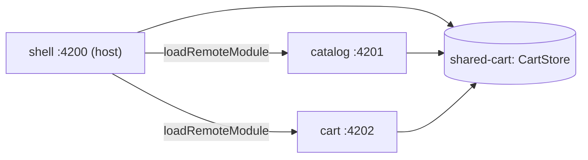

# ☕ Coffee Shop – Angular Native Federation + Signals

A learning project: a coffee shop built as **micro frontends** with Angular 22,
**Native Federation**, **Signals** and **pnpm**.

## What this project teaches

- splitting an app into a host (`shell`) and independent remotes (`catalog`, `cart`),
- loading remotes at runtime (`loadRemoteModule`) and sharing dependencies,
- shared state across micro frontends built on signals (`shared-cart`),
- modern Angular: standalone components, `signal`, `computed`, `effect`, `inject`, `@if` / `@for`.

> This project uses **Native Federation** (esbuild + standard ES modules) rather than classic webpack-based
> Module Federation, because modern Angular builds with esbuild.

## Architecture

| Project (`projects/`) | Port | Role |
|---|---|---|
| `shell` | 4200 | Host: header, navigation, cart counter, routing that loads the remotes |
| `catalog` | 4201 | Remote: coffee menu, search, price filter, "Add to cart" |
| `cart` | 4202 | Remote: cart, quantity changes, removal, total |
| `shared-cart` | – | Library with `CartStore` (signals), shared as a singleton |



When you add a coffee in `catalog`, the badge in `shell` and the list in `cart` update instantly,
because all apps use the same `CartStore` instance.

## Requirements

- Node.js LTS (tested on v26)
- pnpm (`npm install -g pnpm`)

Angular CLI is installed **locally** in the project (not globally) – run it with `pnpm exec ng ...`.

## Running

```bash
pnpm install
pnpm start
```

`pnpm start` runs `ng serve` for `shell`, `catalog` and `cart` in parallel.
Then open http://localhost:4200.

> In PowerShell, if `.ps1` scripts are blocked, use `pnpm.cmd start`
> or run once: `Set-ExecutionPolicy -Scope CurrentUser RemoteSigned`.

A single app (e.g. to work on the catalog alone):

```bash
pnpm exec ng serve catalog
```

Build:

```bash
pnpm exec ng build shell
```

## Where to look

| Topic | File |
|---|---|
| Signal-based state (`signal`, `computed`, `effect`) | `projects/shared-cart/src/lib/cart-store.ts` |
| Filtering with `computed` | `projects/catalog/src/app/app.ts` |
| Loading remotes (routing) | `projects/shell/src/app/app.routes.ts` |
| Remote URLs | `projects/shell/public/federation.manifest.json` |
| What a remote exposes and shares | `projects/*/federation.config.mjs` |
| `shared-cart` library alias | `tsconfig.json` (`paths`) |

## Ideas for further learning

- a fourth remote, e.g. "Orders",
- `linkedSignal` and `resource()` (e.g. fetching the menu from an API),
- component tests with signals,
- `@defer` for lazy-loading parts of a view.
